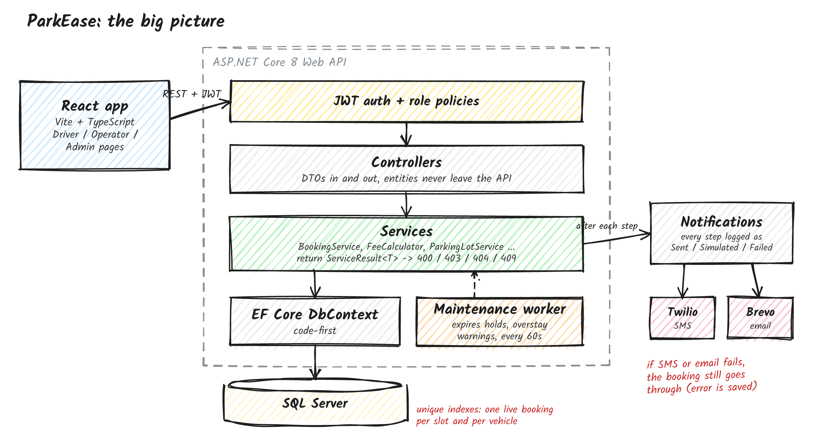

# ParkEase

A parking management system I built as a proof of concept during my internship at Kanini. Drivers reserve a slot, check in and exit, and the system works out the fee and sends a receipt. Operators manage their own lots, and an admin sees everything.

Built with an ASP.NET Core 8 API (EF Core, SQL Server, JWT) and a React + TypeScript frontend.


## How a booking works

1. **Reserve.** A free slot of the right type (car or bike) is held for 15 minutes at no charge. Unclaimed holds expire on their own.
2. **Check in.** The slot becomes occupied and billing starts.
3. **Exit.** The fee is calculated (hours rounded up, 1.5x after 24 hours), the slot is freed, and a receipt goes out by email.

You can cancel for free any time before check-in.


## Roles

- **Driver:** manages their vehicles and bookings
- **Operator:** manages their own lots and slots, and checks vehicles in and out
- **Admin:** everything an operator can do, across all lots, plus the system report

## How it's built



Controllers call services, services use EF Core, and DTOs sit at every API boundary so database entities never leak out.

A few decisions I'm happy with:

- **No double-booking.** A filtered unique index in SQL Server stops two people grabbing the same slot, even if they click at the same moment.
- **Nothing gets silently deleted.** Foreign keys use `Restrict` instead of cascade, so deleting an operator can't wipe out their lots and booking history.
- **Notifications never block a booking.** If an email fails, the booking still goes through and the failure is logged.
- **Operators only see their own lots.** Anyone else's lot returns 404.

## Run it

**Backend** (needs .NET 8 and SQL Server)

```bash
cd backend/ParkEase.Api
cp appsettings.Development.example.json appsettings.Development.json
# set your SQL Server connection and a Jwt:Key (32+ characters)
dotnet run
```

The API runs at http://localhost:5241 with Swagger at `/swagger`. Demo data loads on first run.

**Frontend** (needs Node 20+)

```bash
cd frontend
npm install
npm run dev
```

Open http://localhost:5173

**Demo logins**

| Role | Email | Password |
|---|---|---|
| Admin | admin@parkease.com | Admin@123 |
| Operator | operator@parkease.com | Operator@123 |
| Driver | driver@parkease.com | Driver@123 |

## Known limits

- No real payments. Fees are calculated and recorded only
- Admins can only be created by the seeder
