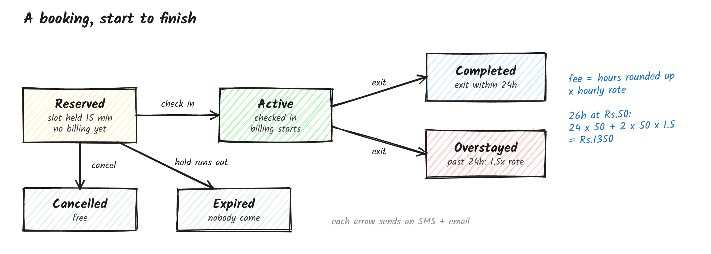

# ParkEase

A parking booking system I built end to end: ASP.NET Core 8 API, React + TypeScript frontend, SQL Server.

A driver adds their car or bike, reserves a free slot of the right type, checks in when they arrive, and pays when they leave. Operators manage their own lots and run the gate. Admins see everything. Every step sends an SMS and an email.

<!-- SCREENSHOTS: driver booking page, operator slot map, admin report go here -->

## How it fits together


Pretty standard layering: Controllers, then Services, then EF Core. Some rules I stuck to:

- **Entities never leave the API.** Every endpoint takes and returns DTOs.
- **Services don't throw for business errors.** They return a `ServiceResult<T>`, and the controller turns its error code into a 400, 403, 404 or 409.
- **The database has the final say on double booking.** Two filtered unique indexes allow only one live booking per slot and per vehicle. If two drivers grab the same slot at the same moment, one wins and the other gets a clean 409 instead of a 500.
- **Time comes from `TimeProvider`**, so expiry and overstay logic is tested with a fake clock instead of `Thread.Sleep`.

## A booking, start to finish



I split booking into **reserve** and **check in** on purpose. Billing starts at check-in, so a driver who's late or doesn't show up isn't charged, and the slot isn't blocked forever. The hold just expires after 15 minutes. A background worker runs every minute to expire stale holds and send overstay warnings.

Fees: hours are rounded up (61 minutes bills 2 hours), and every hour past 24 is billed at 1.5x.

Full rules, the sequence diagram and the notification matrix are in [docs/FLOW.md](docs/FLOW.md). The data model is in [docs/ER-diagram.md](docs/ER-diagram.md).

## Roles

| Role | Can do |
|---|---|
| Driver | Add vehicles, reserve, check in, exit, cancel own bookings, see own alerts |
| Operator | Manage own lots and slots, put slots in maintenance, see which vehicle is in which slot, check vehicles in and out |
| Admin | Everything an operator can do, for every lot, plus the occupancy and revenue report |

Operators get a 404 for lots that aren't theirs, not a 403, so lot ids can't be probed.

## Stack

**Backend:** ASP.NET Core 8, EF Core 8 (code-first), SQL Server, JWT, BCrypt, Swagger
**Frontend:** React 19, TypeScript, Vite, Tailwind, React Router, Axios
**Notifications:** Twilio for SMS (or a stub that just logs), Brevo for email
**Tests:** xUnit with EF Core InMemory

## Run it locally

You need the .NET 8 SDK, Node 20+ and SQL Server (Express or LocalDB).

```bash
# backend
cd backend/ParkEase.Api
cp appsettings.Development.example.json appsettings.Development.json
# set your SQL Server connection string and a 32+ char Jwt:Key in that file
dotnet run              # migrates and seeds demo data, Swagger at /swagger

# frontend
cd frontend
npm install
npm run dev             # http://localhost:5173
```

Demo logins (seeded on an empty database):

| Role | Email | Password |
|---|---|---|
| Admin | admin@parkease.com | Admin@123 |
| Operator | operator@parkease.com | Operator@123 |
| Driver | driver@parkease.com | Driver@123 |

SMS is simulated by default: messages are saved with status `Simulated` and nothing is sent. Every config key, how to switch on real Twilio SMS, and the deploy guide are in [docs/SETUP.md](docs/SETUP.md) and [docs/DEPLOY.md](docs/DEPLOY.md).

Tests:

```bash
cd backend
dotnet test ParkEase.Api/ParkEase.Api.slnx
```

They cover the booking lifecycle, vehicle-to-slot matching, fee calculation, expiry and overstay, role scoping, and the notification pipeline including provider failures.

## API

Swagger lists everything. A Postman collection is in `docs/`. The main ones:

| Endpoint | Who | What |
|---|---|---|
| `POST /api/auth/register`, `/login` | anyone | accounts |
| `GET/POST/DELETE /api/vehicles` | Driver | vehicles |
| `GET /api/parkinglots/browse`, `/{id}/slots` | any user | find a slot |
| `POST /api/bookings` | Driver | reserve |
| `POST /api/bookings/{id}/check-in`, `/exit`, `/cancel` | owner, operator, admin | lifecycle |
| `GET /api/bookings/lot/{lotId}` | Operator, Admin | who's parked where |
| `GET /api/reports/overview` | Admin | occupancy and revenue |

## Known gaps

- Real Twilio delivery has only been tested against a stubbed endpoint. Sending to Indian numbers in production also needs DLT registration.
- Admins only come from the seeder; there's no invite flow yet.
- The fee is calculated and stored, but there's no payment integration.
