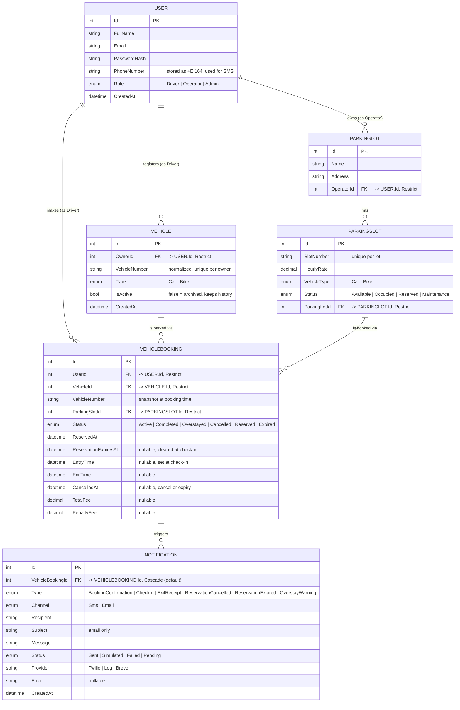

# ParkEase — Entity Relationship Diagram

Reflects the EF Core model in `backend/ParkEase.Api/Models` and the configuration in
`ApplicationDbContext.OnModelCreating`. Every foreign key is `DeleteBehavior.Restrict` except
`Notification → VehicleBooking`, which was never configured explicitly and so uses the EF Core
default (cascade, because the FK is required).

`BookingStatus` is stored as an int, and the original values are unchanged: `Active` = 0, `Completed` = 1,
`Overstayed` = 2, `Cancelled` = 3; `Reserved` = 4 and `Expired` = 5 were added later.

## Constraints that carry the business rules

| Constraint | Purpose |
|---|---|
| Unique `(ParkingLotId, SlotNumber)` | no two slots with the same label in a lot |
| Unique `(OwnerId, VehicleNumber)` | a driver can't register the same plate twice |
| Unique `ParkingSlotId` where `Status IN (0, 4)` | **one live booking per slot**, enforced by the database |
| Unique `VehicleId` where `Status IN (0, 4)` | **one live booking per vehicle**, enforced by the database |
| Index `(VehicleBookingId, Type)` on Notification | cheap "already warned?" check for overstay warnings |

All `DateTime` columns are stored and read as UTC (a value converter in the DbContext marks them as such).

## Why `Restrict`, not `Cascade`

Every relationship that touches booking history is deliberately `Restrict`. Deleting a lot that still has
slots, or a slot or vehicle that still has bookings, fails at the database level instead of silently wiping
historical, potentially financial, records. The API mirrors this with friendly errors:

* a slot with booking history cannot be deleted (set it to maintenance instead);
* a vehicle with history is archived (`IsActive = false`) rather than deleted, and is restored if the driver adds the same plate again;
* a lot with slots cannot be deleted.

`Notification → VehicleBooking` is the exception: a notification is a delivery log for a booking, not data
worth keeping if the booking itself were ever removed.
