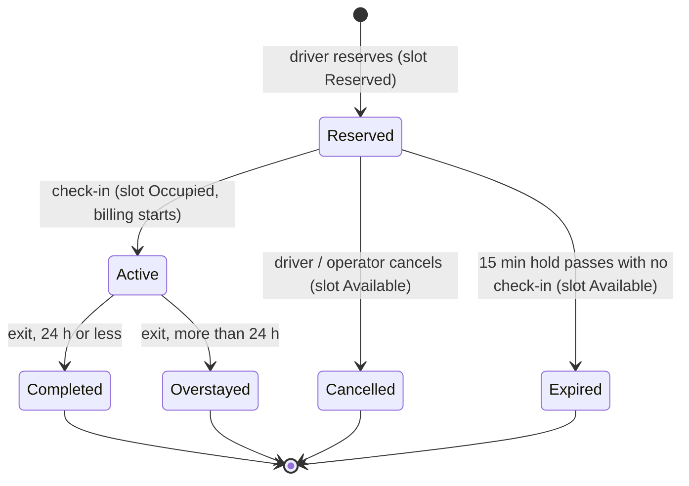
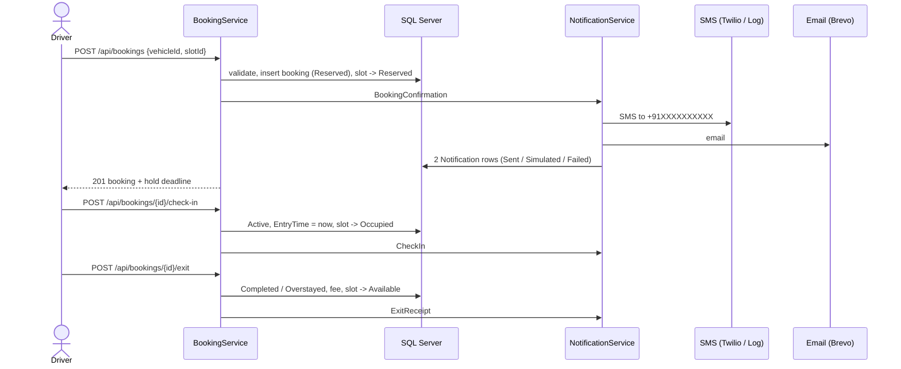

# ParkEase — End-to-End Flow

This is the single reference for how a vehicle gets mapped to a slot, what states a booking moves
through, and which SMS/email goes out at each step. The code that enforces it lives in
`BookingService`, `FeeCalculator` and `NotificationTemplates`.

## 1. Vehicle → slot mapping

A booking ties **one vehicle** to **one slot**. Nothing is free text.

| Rule | Enforced by |
|---|---|
| The vehicle must belong to the driver making the booking | `ReserveAsync` (404 otherwise) |
| The vehicle type (Car / Bike) must equal the slot's type | `ReserveAsync` (400) and the UI, which dims non-matching slots |
| The slot must be `Available` (not Reserved, Occupied or Maintenance) | `ReserveAsync` (409) |
| A slot can have at most one live booking | Filtered unique index `UX_VehicleBookings_OneLiveBookingPerSlot` |
| A vehicle can have at most one live booking | Filtered unique index `UX_VehicleBookings_OneLiveBookingPerVehicle` |
| Plates are stored normalized (`TN09AB1234`) | `VehicleNumber.Normalize` |

"Live" means status `Reserved` or `Active`. The unique indexes are the last line of defence: two drivers
racing for the same slot cannot both win, and the loser gets a 409 instead of a 500.

## 2. Booking lifecycle

| Step | Who | Slot status | Billing |
|---|---|---|---|
| Reserve | Driver | Reserved | none |
| Check in | Driver, or the lot's Operator / an Admin at the gate | Occupied | starts at check-in time |
| Exit | Driver, or the lot's Operator / an Admin | Available | fee fixed at exit time |
| Cancel | Driver, or the lot's Operator / an Admin | Available | none |
| Expire | Background worker, or lazily when a late check-in is attempted | Available | none |

Time spent only reserved is never billed. Cancelling or letting a hold lapse is free.

### Fees

* Hours are rounded **up**, with a minimum of 1 hour (61 minutes bills 2 hours).
* Up to 24 hours bills at the slot's hourly rate.
* Every hour past 24 bills at **1.5x** the rate; that part is reported as `PenaltyFee`.
* The amount owed is `TotalFee + PenaltyFee`.

Example: 26 hours at Rs.50 gives `TotalFee` 1200 (24 x 50) and `PenaltyFee` 150 (2 x 50 x 1.5), so Rs.1350 is due.

## 3. Sequence

## 4. Notification matrix

Every event sends **one SMS and one email** and stores **two `Notification` rows**.

| Event | `NotificationType` | Triggered by |
|---|---|---|
| Slot reserved, with check-in deadline | `BookingConfirmation` | reserve |
| Vehicle checked in, billing started | `CheckIn` | check-in |
| Receipt with duration, fee and any overstay penalty | `ExitReceipt` | exit |
| Reservation cancelled, no charge | `ReservationCancelled` | cancel |
| Hold ran out, no charge | `ReservationExpired` | expiry worker or late check-in |
| About to cross 24 h (sent once, at 23 h or more) | `OverstayWarning` | background worker |

Delivery rules:

* The phone number is normalized to E.164 (`9876543210` becomes `+919876543210`); an invalid number marks the SMS row `Failed` with the reason and the email still goes out.
* SMS text uses `Rs.` rather than the rupee sign so it stays in the GSM-7 alphabet (160 characters per segment instead of 70).
* Times in messages are shown in IST.
* A failure never undoes a booking. `NotifyAsync` swallows and records errors.
* Row status: `Sent` (accepted by the provider), `Simulated` (no provider configured, nothing delivered), `Failed` (with `Error`).
* Drivers can see their own rows, including failures, on the Alerts page (`GET /api/notifications/mine`).

### Providers

| Channel | Default | Real delivery |
|---|---|---|
| SMS | `Log` provider: records the message, delivers nothing | `Sms:Provider = Twilio` plus credentials (see README) |
| Email | Brevo when `Brevo:ApiKey` and `Brevo:SenderEmail` are set, otherwise `Simulated` | Brevo |

## 5. Who can do what

| Action | Driver | Operator | Admin |
|---|---|---|---|
| Manage own vehicles | yes | no | no |
| Reserve a slot | yes | no | no |
| Check in / exit / cancel | own bookings | bookings in lots they own | any |
| See a lot's bookings and who is mapped to which slot | no | own lots | all |
| Add / delete slots, set maintenance | no | own lots | all |
| Browse lots and slots | yes | yes | yes |
| System report | no | no | yes |

Operators and Admins asking for a booking or lot they don't manage get a 404 rather than a 403, so ids
can't be probed.

## 6. Background worker

`BookingMaintenanceWorker` ticks every `Booking:MaintenanceIntervalSeconds` (default 60) and:

1. expires `Reserved` bookings whose hold has passed and releases their slots (and sends `ReservationExpired`);
2. sends one `OverstayWarning` for each `Active` booking at 23 h or more that has not been warned.

Each tick runs in its own DI scope and a failure is logged without stopping the worker.
